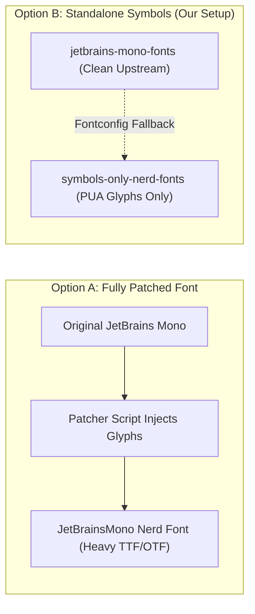

# Fonts, Glyphs & Emojis Guide

> [!TIP]
> **Goal:** Eliminate broken "tofu" boxes (`▯`), enable crisp Nerd Font icons across terminal prompts and Waybar modules, and guarantee vibrant full-color emoji rendering system-wide.

---

## 1. Demystifying Linux Font Rendering

When applications render text on Linux, they use text-shaping engines (**FreeType**, **HarfBuzz**, and **Pango**) governed by **Fontconfig**. 


---

## 2. Why Status Bar & Terminal Icons Break ("Tofu" Boxes)

### Status Bar Icons Are Not Images
Status bar modules in Waybar and terminal CLI prompts do not render PNGs or SVGs; they render literal Unicode characters located in the **Private Use Area (PUA)**:
* `U+E000` to `U+F8FF` (Basic PUA)
* `U+F0000` to `U+FFFFD` (Supplementary PUA)

> [!WARNING]
> Upstream fonts like stock JetBrains Mono or Fira Code contain letters, numbers, and programming ligatures, but **zero icon glyphs**. If Waybar requests `U+F001` (music note) or `U+F240` (battery) and no fallback font covers that codepoint, Pango renders a broken tofu square (`▯`).

---

## 3. Patched Nerd Fonts vs. Standalone Symbols Font

There are two distinct ways to provide Nerd Font glyphs:



### Why We Use `symbols-only-nerd-fonts` on openSUSE:
1. **Lightweight & Modular:** Upstream fonts update independently without waiting for Nerd Font patcher releases.
2. **Clean Monospace Grid:** Avoids metric distortion where wide glyphs stretch or clip neighboring letters in your code editor.
3. **Decoupled:** Works universally across Kitty, Neovim, and Waybar.

---

## 4. The GUI & Waybar Font Stack
 
In [`dot-config/waybar/style.css`](../dot-config/waybar/style.css) and systemwide GTK/Qt configs, the primary GUI font is **Inter**:
 
```css
* {
    font-family: "Inter", "JetBrainsMono Nerd Font Propo", "Symbols Nerd Font", "Noto Color Emoji", sans-serif;
}
```
 
### Why Inter + Nerd Fonts:
* **Inter (`inter-fonts`):** The modern standard for digital screens. Its tall x-height and optical hinting eliminate blur on fractional scaling (e.g., 1.25×).
* **Font Awesome (`fontawesome-fonts`):** Provides legacy media symbols.
* **Nerd Fonts (`symbols-only-nerd-fonts`):** Provides backlight icons (`` to ``), Git branches, and CPU/RAM hardware glyphs.
* **JetBrains Mono (`jetbrains-mono-fonts`):** Dedicated to code, terminals (Kitty), and monospace buffers.

---

## 5. The Black-and-White Emoji Trap

Many base system fonts (such as DejaVu Sans or FreeSerif) include ancient monochrome outline glyphs for standard emojis (e.g. `☕`, `⚠`, `♥`, `★`).

> [!CAUTION]
> If Fontconfig resolves a generic sans-serif font *before* checking your color emoji font, Linux renders the flat, wireframe black-and-white outline instead of the vibrant full-color emoji.

### The Solution:
1. Install **`google-noto-coloremoji-fonts`**.
2. Refresh the system font index:
   ```bash
   fc-cache -fv
   ```
3. Test color emoji rendering in your terminal:
   ```bash
   echo -e "🚀 🔥 💡 🐧 🌸"
   ```
