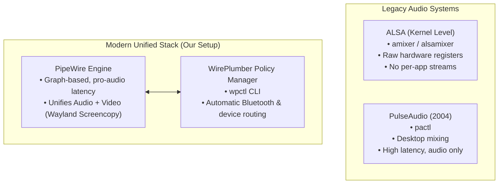

# Modern Audio & Hardware Control Guide

> [!TIP]
> **Goal:** Master modern low-latency PipeWire audio control with WirePlumber (`wpctl`), configure smooth screen brightness controls, and maintain system security permissions.

---

## 1. The Audio Evolution: ALSA ➔ PulseAudio ➔ PipeWire

Understanding the history explains why legacy forum commands break modern Wayland setups:



### Why Legacy Commands Are Outdated:
* **`amixer` / `alsamixer`:** Operates at the raw hardware ALSA register level. Adjusting volume with `amixer` often locks the physical sound card amplifier rather than scaling software streams.
* **`pactl`:** Operates through a PulseAudio emulation translation layer.
* **`wpctl` (WirePlumber):** The native CLI for the modern Linux audio subsystem. It speaks directly to the PipeWire graph manager.

---

## 2. Audio Control with `wpctl`

WirePlumber's `wpctl` provides clean, reliable endpoint controls:

```bash
# 1. Inspect audio endpoints, sinks (speakers), and sources (microphones)
wpctl status

# 2. Adjust volume safely with an upper ceiling (1.0 = 100% volume max)
wpctl set-volume -l 1 @DEFAULT_AUDIO_SINK@ 5%+
wpctl set-volume @DEFAULT_AUDIO_SINK@ 5%-

# 3. Toggle mute states
wpctl set-mute @DEFAULT_AUDIO_SINK@ toggle
wpctl set-mute @DEFAULT_AUDIO_SOURCE@ toggle
```

> [!NOTE]
> The `-l 1` flag prevents audio clipping or distortion by enforcing an upper volume limit of 100%.

### Keybindings in `hyprland.lua`:
These commands are mapped directly to your laptop multimedia keys in [`hyprland.lua`](../dot-config/hypr/hyprland.lua):
```lua
hl.bind("XF86AudioRaiseVolume", hl.dsp.exec_cmd("wpctl set-volume -l 1 @DEFAULT_AUDIO_SINK@ 5%+"), { locked = true, repeating = true })
hl.bind("XF86AudioLowerVolume", hl.dsp.exec_cmd("wpctl set-volume @DEFAULT_AUDIO_SINK@ 5%-"),      { locked = true, repeating = true })
hl.bind("XF86AudioMute",        hl.dsp.exec_cmd("wpctl set-mute @DEFAULT_AUDIO_SINK@ toggle"),     { locked = true, repeating = true })
hl.bind("XF86AudioMicMute",     hl.dsp.exec_cmd("wpctl set-mute @DEFAULT_AUDIO_SOURCE@ toggle"),   { locked = true, repeating = true })
```

---

## 3. Backlight Control (`brightnessctl`)

Laptop displays do not scale brightness linearly; the human eye perceives brightness changes logarithmically.

In [`hyprland.lua`](../dot-config/hypr/hyprland.lua), brightness keys use smooth exponential curve scaling:
```lua
hl.bind("XF86MonBrightnessUp",   hl.dsp.exec_cmd("brightnessctl -e4 -n2 set 5%+"), { locked = true, repeating = true })
hl.bind("XF86MonBrightnessDown", hl.dsp.exec_cmd("brightnessctl -e4 -n2 set 5%-"), { locked = true, repeating = true })
```
* `-e4`: Applies an exponential curve so lower brightness levels have fine-grained adjustments while high levels scale quickly.
* `-n2`: Sets a minimum threshold so you never accidentally dim your display to absolute pitch black.

---

## 4. Hardware Permissions & Security Notice

Grant your user permission to control backlight devices without `sudo`:

```bash
sudo usermod -aG video $USER
```

> [!CAUTION]
> ### The `input` Group Security Risk
> Many outdated online tutorials instruct users to run: `sudo usermod -aG video,input $USER`.
> **Never add a standard user to the `input` group.**
>
> In Linux, membership in the `input` group grants unprivileged processes direct read access to `/dev/input/event*`. Any program running under your user account (including untrusted web scripts, games, or background apps) can silently log every keystroke you type (including passwords) across all applications.
>
> Modern `systemd-logind` dynamically handles input devices for the active Wayland session safely. The `video` group alone handles backlight control.
