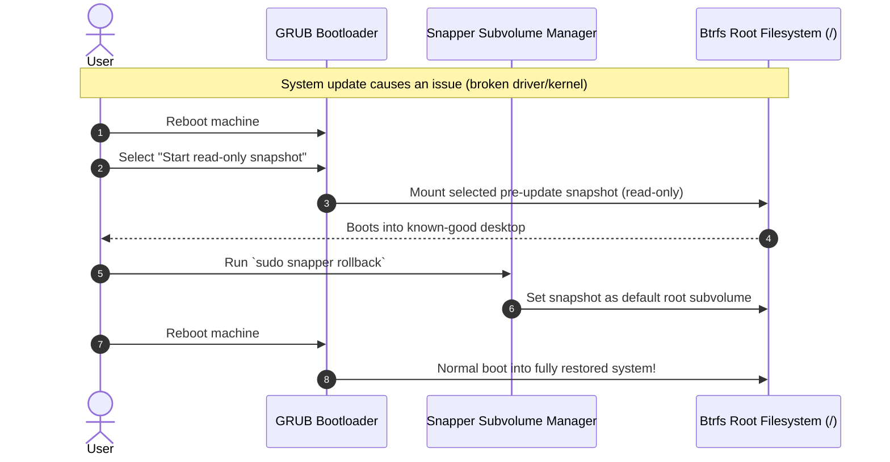

# openSUSE Tumbleweed System Guide

> [!TIP]
> **Goal:** Keep openSUSE Tumbleweed strictly minimal, maintain rolling-release stability, enable proprietary multimedia codecs (Packman), and leverage Btrfs Snapper rollbacks as an unbreakable safety net.

---

## 1. The Zypper Bloat Trap (Recommends vs. Requires)

In openSUSE RPM packaging:
* **`Requires:`** Hard dependencies. The application cannot run without them (e.g. `glibc`).
* **`Recommends:`** Soft dependencies. Packages suggested by upstream maintainers (e.g. extra themes, documentation, games, print daemons).

### The Problem:
By default, Zypper treats "recommends" as hard dependencies (`solver.onlyRequires = false`). On a minimal "Text Mode" install, installing a single desktop tool causes Zypper to pull hundreds of unwanted packages.

### The Permanent Fix:
1. Lock Zypper to hard dependencies only in `/etc/zypp/zypp.conf`:
   ```ini
   solver.onlyRequires = true
   ```
2. Always execute system upgrades with:
   ```bash
   sudo zypper dup --no-recommends
   ```

> [!IMPORTANT]
> ### Always Use `zypper dup`, Never `zypper up`
> openSUSE Tumbleweed is a rolling release where library ABIs continuously change.
> * `zypper up` performs shallow package updates without vendor changes or package removals, causing split package states and dependency breakage.
> * **Always use `zypper dup`** (distribution upgrade) to maintain clean, consistent packages.

---

## 2. Proprietary Multimedia Codecs (`opi codecs`)

openSUSE strictly adheres to international patent laws. Official openSUSE repositories cannot distribute patent-encumbered codecs (H.264, H.265/HEVC, AAC, proprietary MP4 decoders). Out of the box, browsers cannot play YouTube videos and music players cannot decode MP4/AAC streams.

### The Solution:
The community-maintained **Packman** repository rebuilds multimedia packages with full codec support enabled.

Instead of manually editing repository URLs, use `opi` (openSUSE Package Installer):
```bash
sudo zypper in --no-recommends opi
opi codecs
```
`opi codecs` automatically adds the appropriate Packman mirror, performs the required vendor package switch, and verifies hardware video acceleration.

---

## 3. The Unbreakable Safety Net: Snapper Btrfs Rollbacks

Because openSUSE Tumbleweed installs by default with Btrfs and Snapper, every Zypper transaction automatically generates lightweight Copy-on-Write (CoW) snapshots before and after package changes.



### The Rollback Recovery Workflow:
If an update ever causes an issue with your display server or GPU driver:
1. Reboot the PC.
2. In the GRUB boot menu, select **"Start read-only snapshot"** and pick the snapshot taken prior to the update.
3. The system boots into a read-only instance of your known-good working system.
4. Open a terminal and run:
   ```bash
   sudo snapper rollback
   sudo reboot
   ```
5. Snapper sets that snapshot as the new default root subvolume. The system is restored in seconds with zero data loss. User files in `/home` are preserved on their own subvolume.
