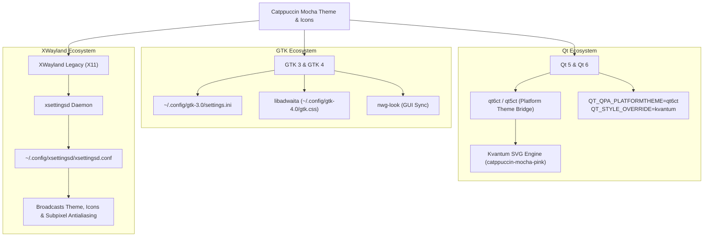
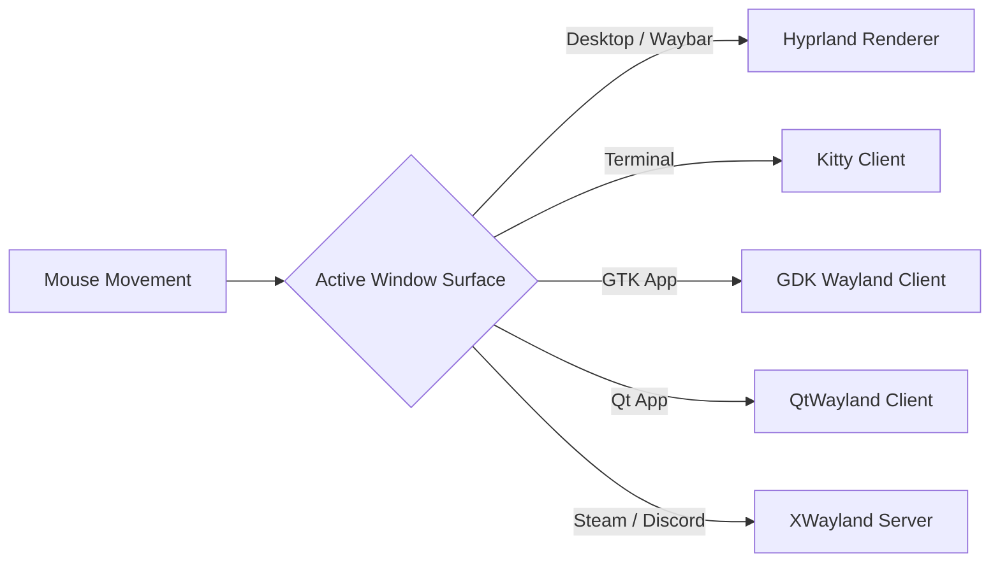

# Theming & Visual Consistency Guide

> [!TIP]
> **Goal:** Achieve a unified **Catppuccin Mocha** dark aesthetic across GTK 3, GTK 4 (libadwaita), Qt 5, Qt 6, terminal windows, and legacy XWayland applications—with zero cursor jumping or mismatched styles.

---

## 1. The Dual-Toolkit Curse (Why Linux Ricing Is Convoluted)

In a monolithic Desktop Environment (like GNOME or KDE Plasma), hidden background daemons constantly push appearance settings to all running applications. 

**Hyprland is a standalone Wayland compositor, not a desktop environment.** It manages windows, animations, and input, but **deliberately does not manage** application widget styles, theme engines, icon sets, or font smoothing.

Without a centralized daemon, every UI toolkit defaults to its own compile-time fallback:
* **GTK apps** revert to raw Adwaita Light or bundled CSS.
* **Qt apps** revert to basic "Fusion" or 1990s Windows-style boxes.
* **XWayland apps (Steam, Discord, Spotify)** revert to un-antialiased serif fonts and default X11 styling.
* **Libadwaita apps** ignore user GTK3 themes entirely.

To achieve visual consistency, we coordinate four distinct layers:



---

## 2. GTK 3 & GTK 4 (libadwaita)

### The libadwaita Theming Trap
Historically in GTK3, themes injected CSS that monkey-patched widget selectors. In GTK4, GNOME introduced **`libadwaita`**, which bundles its stylesheet directly into the application binary and **intentionally ignores `gtk-theme-name` in `settings.ini`**.

> [!NOTE]
> Setting a theme in `settings.ini` or `nwg-look` styles GTK3 and non-libadwaita GTK4 apps. Libadwaita apps will stay default unless user stylesheet overrides are provided.

To ensure GTK4/libadwaita apps conform to Catppuccin Mocha:
1. Standard GTK3 applications read `~/.config/gtk-3.0/settings.ini`.
2. Libadwaita apps read custom stylesheet overrides from `~/.config/gtk-4.0/gtk.css`.
3. Use **`nwg-look`** (a lightweight GUI tool for Wayland) to apply the theme and export libadwaita CSS overrides automatically.

---

## 3. Qt 5 & Qt 6 (qt6ct + Kvantum)

Qt is written in C++ and renders widgets using programmatic drawing primitives (`QPainter`). It has zero native understanding of GTK CSS stylesheets.

### The Solution:
1. **`qt6ct` & `qt5ct` (Configuration Bridge):**  
   We tell Qt to delegate font, icon, and widget style queries to `qt6ct` via the environment variable:
   ```lua
   hl.env("QT_QPA_PLATFORMTHEME", "qt6ct")
   ```
2. **Kvantum (SVG Style Engine):**  
   Qt's built-in styles (`Fusion`, `Windows`) only allow changing basic solid colors. **Kvantum** is an SVG-based theme engine that draws Qt widgets using vector artwork.
3. In [`hyprland.lua`](../dot-config/hypr/hyprland.lua), we enforce Kvantum:
   ```lua
   hl.env("QT_STYLE_OVERRIDE", "kvantum")
   ```
4. This repository stores the Catppuccin Mocha Pink theme in [`dot-config/Kvantum/catppuccin-mocha-pink/`](../dot-config/Kvantum/catppuccin-mocha-pink).

---

## 4. Legacy XWayland Apps (`xsettingsd`)

Legacy X11/XWayland applications (e.g. Steam, Discord, GIMP, Spotify) cannot query Wayland portals or GSettings. Under X11, settings are broadcast through the **XSETTINGS specification**.

Hyprland does not run an XSETTINGS daemon by default. Without one, XWayland apps launch with ugly un-antialiased fonts and mismatched themes.

### The Solution:
The repository includes [`dot-config/xsettingsd/xsettingsd.conf`](../dot-config/xsettingsd/xsettingsd.conf), which broadcasts:
* Theme: `catppuccin-mocha-pink-standard+default`
* Icons: `kora`
* Subpixel rendering: `Xft/Antialias 1`, `Xft/RGBA "rgb"`, `Xft/HintStyle "hintslight"`

`xsettingsd` is autostarted in [`hyprland.lua`](../dot-config/hypr/hyprland.lua) on launch.

---

## 5. Curing Cursor Mutation (Theme & Size Jumping)

### Why Cursors Mutate:
Under Wayland's `wl_pointer` protocol, **there is no central server drawing the cursor**. When your mouse enters a window, **that application renders its own cursor buffer**:



If any of these layers has a different cursor size or theme configured, the cursor will visibly jump, change shape, or turn into an ancient black 'X'.

### The 5 Synchronization Points:
To ensure the cursor never mutates, all 5 runtimes are aligned to size `24`:
1. **Hyprland Environment ([`hyprland.lua`](../dot-config/hypr/hyprland.lua)):**
   ```lua
   hl.env("XCURSOR_SIZE", "24")
   hl.env("HYPRCURSOR_SIZE", "24")
   ```
2. **GTK 3/4 Settings (`~/.config/gtk-3.0/settings.ini`):**
   ```ini
   gtk-cursor-theme-size = 24
   ```
3. **XWayland Daemon ([`dot-config/xsettingsd/xsettingsd.conf`](../dot-config/xsettingsd/xsettingsd.conf)):**
   ```ini
   Gtk/CursorThemeName "default"
   ```
4. **X11 Resources ([`dot-Xresources`](../dot-Xresources)):**
   ```ini
   Xcursor.size: 24
   ```
5. **Qt Settings ([`dot-config/qt6ct/qt6ct.conf`](../dot-config/qt6ct/qt6ct.conf)):** Configured to match size 24.

---

## 6. Installing Theme Assets

To populate the themes referenced across `xsettingsd.conf`, `nwg-look`, and `qt6ct.conf`:

```bash
# 1. Catppuccin GTK Theme (Unpack into ~/.themes)
mkdir -p ~/.themes
curl -LO "https://github.com/catppuccin/gtk/releases/download/v1.0.3/catppuccin-mocha-pink-standard+default.zip"
unzip catppuccin-mocha-pink-standard+default.zip -d ~/.themes/
rm catppuccin-mocha-pink-standard+default.zip
```

> [!TIP]
> `kora-icon-theme` is installed directly as a system package via `sudo zypper in --no-recommends kora-icon-theme`, ensuring GTK and Qt locate icons cleanly without manual extraction.
