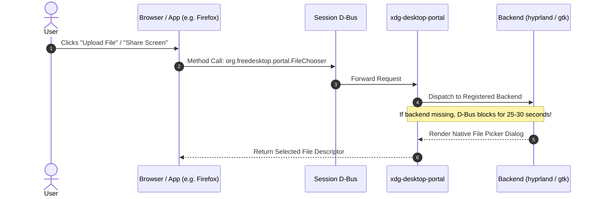
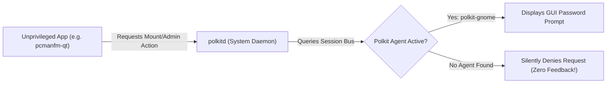

# Wayland, Portals & Polkit Guide

> [!TIP]
> **Goal:** Understand how Wayland isolates applications, eliminate the dreaded 30-second file picker freeze, enable graphical root authentication dialogs, and configure native Wayland environment variables.

---

## 1. Standalone Compositor vs. Desktop Environment

Unlike monolithic environments (GNOME, Plasma) that ship pre-integrated background services, **Hyprland is strictly a Wayland compositor and window manager**. 

To maintain security, Wayland enforces strict process isolation:
* Client applications cannot inspect other windows' buffers.
* Client applications cannot capture the screen arbitrarily.
* Client applications cannot execute global keystroke hooks or launch root-privileged GUI dialogs without explicit IPC brokers.

These capabilities require two critical subsystems: **XDG Desktop Portals** and **Polkit Authentication Agents**.

---

## 2. XDG Desktop Portals & The 30-Second Freeze

The **XDG Desktop Portal** (`org.freedesktop.portal.Desktop`) is a standardized D-Bus IPC framework bridging client applications and desktop services:



### Why Applications Freeze for 25–30 Seconds:
When an application requests a file picker or screen capture, it initiates a synchronous D-Bus call to the portal:
* If no backend is registered, or if backends deadlock, **the default D-Bus timeout is 25 to 30 seconds**.
* The application's UI thread completely hangs. The window greys out or becomes unresponsive before either crashing or falling back to an obsolete file picker.

### The Dual-Backend Solution in Hyprland:
Hyprland requires **two backends running together**:
1. **`xdg-desktop-portal-hyprland` (XDPH):** Implements Wayland-native screen-casting (`zwlr_screencopy_v1`) and window capture. It does **not** implement a file chooser.
2. **`xdg-desktop-portal-gtk`:** Implements the GTK file chooser dialog and dark mode preference broadcasts.

> [!IMPORTANT]
> If you only install `xdg-desktop-portal-hyprland`, file pickers have no provider, leading directly to the 30-second D-Bus freeze. Both backends are strictly required.

---

## 3. Polkit Authentication Agents



### Why Root Actions Silently Fail:
`sudo` is a terminal command that elevates an entire process. **Polkit** is an application-level privilege framework that allows regular apps to request specific root permissions (e.g., mounting an internal drive, managing VPNs, changing system time).

* Desktop environments automatically start an authentication agent.
* Hyprland **ships with no agent whatsoever**.

If no agent is running, `polkitd` finds no UI to prompt for your password and **silently denies the request**. To the user, clicking an unmounted hard drive in `pcmanfm-qt` appears completely broken.

### The Fix:
We install `polkit-gnome` and autostart it in [`hyprland.lua`](../dot-config/hypr/hyprland.lua):
```bash
/usr/libexec/polkit-gnome-authentication-agent-1 &
```

---

## 4. Essential Wayland Environment Variables

To prevent applications from defaulting to legacy X11 / XWayland mode, [`hyprland.lua`](../dot-config/hypr/hyprland.lua) exports:

| Variable | Value | Purpose |
| :--- | :--- | :--- |
| `QT_QPA_PLATFORM` | `wayland;xcb` | Forces Qt5/6 apps to run natively on Wayland. |
| `QT_QPA_PLATFORMTHEME` | `qt6ct` | Directs Qt to read styling from `qt6ct` rather than searching for KDE. |
| `QT_STYLE_OVERRIDE` | `kvantum` | Enforces Kvantum as the active SVG widget style engine. |
| `XCURSOR_SIZE` | `24` | Aligns Wayland cursor dimensions. |
| `HYPRCURSOR_SIZE` | `24` | Aligns Hyprland vector cursor dimensions. |
